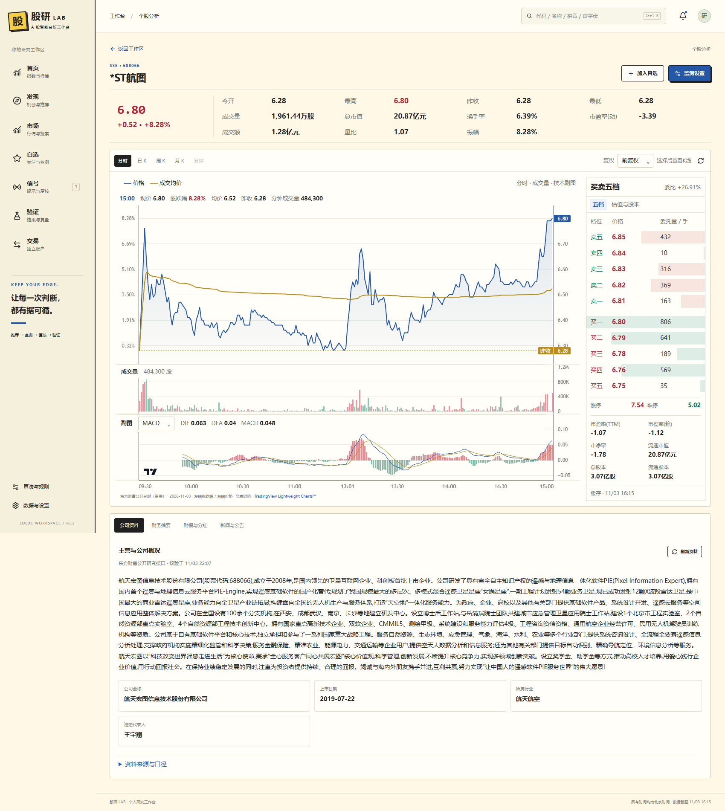
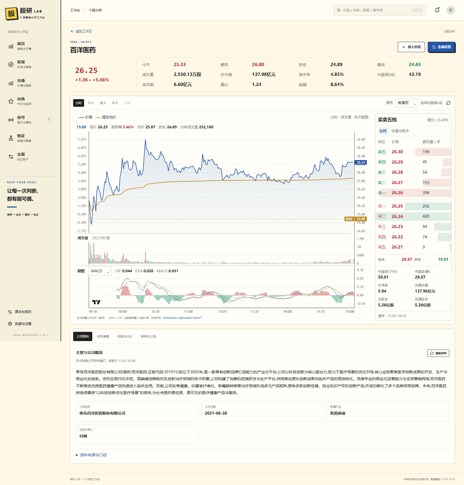

# 分时来源故障恢复

2026-11-03，用户截图中的*ST航图688066、百洋医药301015均有报价和五档、分时为空。

## 根因与修正

腾讯 `web.ifzq.gtimg.cn/appstock/app/minute/query` 实测HTTP501并返回拦截页，且新易盛及上证指数亦如此；报价走qt.gtimg.cn，故可独立成功。原程序只有一个分时源；“重试”仅重新读取缓存，顶部刷新只同步快照，没有提交分时刷新。失败空记录文案又误称“已保留缓存”。

现在主源失败时切换独立东方财富公开分时，完整序列替换，不混拼来源；来源、日期和主源失败原因在图表标识（悬浮可看原因）。每批已失败主源不重复请求，下一批仍会尝试主源。双源失败保留已有点，没有点则明确报告尚未取得。重试和刷新会真实POST目标行情后台刷新，自动更新关闭时显式请求仍可执行。来源失败不绕过拦截、不用快照构造假分时。

东方财富f56为手，包括科创板，统一乘100得到股；累计成交量/额从同一完整序列计算股票均价，指数不使用股票VWAP。校验证券市场、代码、日期、顺序、非负量额和有效价格；拒绝空序列、混日或错误身份。来源自身preClose用于对应分时涨跌幅。

## 验证

- [正式API](live-api.json)：两股均241点，来源东方财富，fallback=true，primary_error为腾讯HTTP501，末价6.80/26.25，error=null。秒数为排队后读到已有成功缓存的时间，不代表首次抓取速度。
- [浏览器](ui-results.json)：两股实际曲线、均价线、三层图表可见，来源标识正确，无错误横幅、页面错误0；独立浏览器拦截模拟双源失败、点击重试捕获目标POST后成功恢复，不写测试假行情入库。
- 后端269项、前端43项通过；类型检查与生产构建通过。7个新增后端用例覆盖501备用、独立单位、均价、每批失败去重、双源失败/身份/混日/负量/空数据拒绝及显式目标刷新。
- [业务保留](preservation.json)：15条受保护业务记录不变，原762条bars与22081条provider_bars逐条保留，当前provider_bars29434条（后台追加）。唯一8765进程更新为PID55840。
- 前端生产包index-DtTLTdfM.js/index-B0Gv2Ezu.css；OpenAPI50路径，新增可选query及来源元数据契约见API-CONTRACT.md。

公开源无可用性保证，两源同时故障仍可能无分时；会显示真实失败和已保存数据，不能将备用称为持续逐笔推送。
